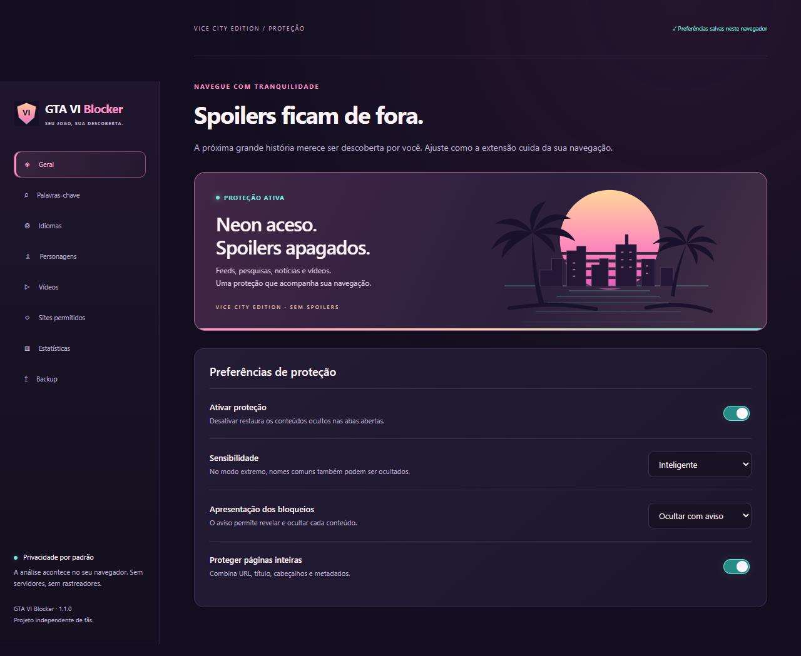

# GTA VI Blocker

Extensão Chrome Manifest V3 para reduzir a exposição involuntária a notícias e spoilers de Grand Theft Auto VI. JavaScript, HTML e CSS, sem frameworks de produção, servidores ou rastreadores.



**Vice City Edition:** tema roxo noturno com rosa neon, turquesa, degradês de pôr do sol e ilustração vetorial de palmeiras. A identidade aparece no popup, nas configurações, nos ícones e nos avisos de proteção. Todos os recursos são locais, com foco visível de teclado, adaptação para telas pequenas e suporte à preferência de movimento reduzido.

## Instalação no Chrome

1. Baixe o ZIP da release e **extraia** em uma pasta permanente, ou clone este repositório.
2. Abra `chrome://extensions` no Chrome 120 ou superior.
3. Ative **Modo do desenvolvedor**, no canto superior direito.
4. Clique em **Carregar sem compactação**.
5. Selecione a pasta que contém `manifest.json` (a raiz deste projeto ou a pasta extraída do ZIP).
6. Fixe **GTA VI Blocker** na barra de extensões e atualize as abas que já estavam abertas.

**Não é necessário instalar Node ou executar um build para usar a extensão.** Os arquivos prontos para carregar já estão incluídos. A publicação no GitHub não instala a extensão no seu navegador e não equivale à distribuição pela Chrome Web Store.

## Funcionalidades

- Detecção Unicode com normalização de acentos, largura completa, caracteres invisíveis, hashtags e separadores; `GTA-VI`, `GTAVI`, `ＧＴＡ Ⅵ`, `GTA 6` e `GrandTheftAutoVI` são reconhecidos.
- 18 conjuntos linguísticos: inglês, alemão, árabe, chinês simplificado e tradicional, indonésio, holandês, francês, espanhol, italiano, japonês, coreano, polonês, português brasileiro, russo, tailandês, turco e vietnamita. Dicionários locais de títulos e contexto, habilitados independentemente do idioma do navegador.
- Motor de confiança reutilizado para cards, páginas e vídeos. Retorna termos, categorias, idiomas associados aos termos e recomendação. Os idiomas retornados não representam identificação linguística de todo o texto.
- Três modos: **Inteligente**, **Rigoroso** e **Extremo**. Nomes comuns isolados não bloqueiam no modo inteligente. No rigoroso, referências moderadas como locais e nomes completos passam a bloquear. No extremo, nomes comuns configurados também bloqueiam. Termos auxiliares como “trailer” nunca bloqueiam isoladamente.
- Palavras-chave com criação, edição, remoção, ativação individual, idioma, categoria, sensibilidade e regras **sempre**, **com contexto** e **auxiliar**. Busca, filtros, paginação, importação/exportação JSON e restauração geral, por categoria e individual. Restauração de sugestões preserva termos personalizados distintos; entradas equivalentes no mesmo idioma são deduplicadas.
- Personagens e NPCs com painel próprio, incluindo Lucia Caminos, Jason Duval, Cal Hampton, Boobie Ike, Dre’Quan Priest, Real Dimez, Raul Bautista e Brian Heder; localidades e referências de contexto também são configuráveis.
- Ocultação do contêiner completo, incluindo miniatura, com aviso discreto ou remoção visual completa. **Mostrar conteúdo** e **Ocultar novamente** afetam apenas o card escolhido. A revelação dura até atualizar ou navegar para outra rota; não existe liberação permanente implícita.
- Controle de sites por domínio exato, com inclusão opcional de subdomínios e correspondência segura: `example.com` não permite `fakeexample.com`.
- Pausa manual ou por 5, 15, 30 e 60 minutos, retomada via `chrome.alarms`, estado no popup e badge `OFF`. Pausar restaura conteúdos ocultos, preservando configurações e contagens.
- Proteção preventiva de vídeos HTML5: tenta pausar, silencia e oculta o player. **Assistir mesmo assim** restaura o estado anterior de áudio e tenta reproduzir somente aquele vídeo. Novos vídeos e mudanças SPA exigem nova análise.
- Bloqueio de página inteira com pontuação de URL, título, h1, metadados e densidade de menções em parágrafos. Tela com voltar, liberação temporária ou permissão para o domínio.
- Observação incremental com MutationObserver, debounce, lotes de até 180 elementos, filas limitadas, cache de resultados e mapas fracos. Cards reciclados são reanalisados ao mudar texto/atributos relevantes. A URL é conferida a cada 750 ms para detectar navegação interna em contextos isolados.
- Estatísticas de bloqueios efetivamente aplicados, por domínio/categoria e vídeos. Revelar, reocultar e pausar não contam o mesmo conteúdo novamente. Um card cujo conteúdo muda pode representar um novo bloqueio.
- Popup e opções em português, tema escuro, navegação por teclado, contraste e layout adaptável, backup completo e comunicação imediata entre abas por `chrome.storage.onChanged`.

## Uso

Abra o popup para pausar/retomar, escolher a sensibilidade, verificar as contagens e permitir o site atual. Os atalhos abrem as seções correspondentes das configurações.

Em **Palavras-chave**, adicione termos exclusivos com a regra **Bloquear sempre**. Use **Exigir contexto** para referências ambíguas e **Apenas auxiliar** para palavras genéricas que só devem fortalecer uma evidência. Termos compartilhados `*` continuam ativos mesmo ao desativar todos os idiomas. Categorias e sensibilidade podem ser alteradas em **Editar**. As sugestões removidas aparecem no painel expansível para restauração individual.

Em **Vídeos**, avisos e liberação individual podem ser desativados. Se os avisos estiverem desativados, ou o estilo for ocultação completa, o conteúdo não terá um botão de revelação: pause a extensão, permita o domínio ou altere o estilo para vê-lo. Desativar a proteção preventiva mantém a filtragem comum de cards, inclusive cards que contenham vídeos.

Depois de **Mostrar conteúdo** ou **Assistir mesmo assim**, atualizações de contadores, miniaturas, rótulos e metadados não cancelam sua escolha. Identificadores estáveis permitem voltar a proteger um contêiner reutilizado para outro post ou vídeo. Sem identificador disponível, a liberação permanece válida para aquele elemento até **Ocultar novamente**, recarregar a página ou mudar a rota. A liberação não é uma permissão para outros cards.

Ao permitir um domínio pai com subdomínios, reativar a proteção pelo popup de um subdomínio remove a regra pai correspondente. Se desejar exceções mais específicas, cadastre domínios exatos na página de opções.

## Estrutura

```text
manifest.json                 Manifest V3 pronto para carregar
background/service-worker.js  Alarmes, estatísticas serializadas e mensagens
content/                      Detector, adaptadores, bloqueio, vídeos, páginas e observer
data/languages/               18 dicionários locais independentes
data/characters.js            Personagens e NPCs
data/keywords.js              Catálogo de sugestões
shared/                       Normalização, validação, storage, constantes e tema
popup/                        Controle rápido
options/                      Gerenciamento completo
icons/                        PNGs 16, 32, 48 e 128 px
tests/                        Vitest + JSDOM e integração Chromium/Playwright
scripts/                      Validação, empacotamento e geração de recursos
.github/workflows/ci.yml       Validação e ZIP em pushes e pull requests
```

Os content scripts são carregados na ordem do manifest em um mundo isolado, usando o namespace `GB`. Isso evita imports de módulos não suportados diretamente em content scripts declarativos. O service worker usa `importScripts`. Não há scripts inline, `eval`, bibliotecas remotas ou recursos de produção que dependam de `node_modules`.

## Desenvolvimento e testes

Requer Node.js 22.12+ ou 24 e npm:

```sh
npm ci
npm run check
npm test
npx playwright install chromium
npm run test:e2e
npm run package
```

O teste de integração inicia um perfil Chromium temporário e isolado com a extensão real carregada, usa uma página HTTP local e reinicia o navegador para conferir persistência. Capturas ficam em `test-results/`. O ZIP instalável fica em `dist/gta-vi-blocker-1.1.0.zip`, sem dependências de desenvolvimento. O workflow também disponibiliza esse ZIP como artefato.

Validação da versão 1.1.0: **70 testes automatizados e 19 verificações de integração passaram**. Veja [TESTING.md](TESTING.md) para ambiente, escopo, página pública verificada e limitações da validação.

Para regenerar os dicionários e o manifest/HTML após editar os respectivos geradores: `node scripts/dictionaries.mjs` e `node scripts/scaffold.mjs`. Os ícones podem ser regenerados no Windows com `powershell -File scripts/icons.ps1`.

## Compatibilidade e limites reais

- Adaptadores de DOM incluem YouTube/Shorts, Google Search/Notícias/Imagens, X, Reddit, Instagram/Facebook (artigos semânticos), TikTok, Twitch, Bing e DuckDuckGo. O mecanismo genérico atende artigos, links, imagens, listas, parágrafos e cards comuns nos demais sites. Mudanças de marcação podem exigir atualização dos seletores. Isso não é uma garantia de cobertura integral em todos esses serviços.
- A filtragem usa texto e metadados disponíveis no DOM. **Não faz OCR, reconhecimento de imagens, transcrição de áudio, tradução ou classificação por IA.** Um spoiler visual sem pistas textuais pode passar despercebido. `GB.Detector.analyze` aceita texto e pode receber sinais de um módulo futuro de OCR, que não está implementado nesta versão.
- Não há garantia de bloquear antes do primeiro frame ou primeiro som. A análise depende do carregamento de metadados e da execução dos scripts; players personalizados, DRM, canvas, shadow DOM fechado e iframes restritos podem impedir análise ou controle. A proteção tenta pausar e silenciar players HTML5 acessíveis.
- Páginas internas (`chrome://`), Chrome Web Store, visualizador PDF do navegador e outras páginas protegidas não aceitam content scripts. Arquivos locais não são cobertos. Abas já abertas exigem atualização após instalação.
- A liberação opcional por sessão da aba não está implementada: a duração adotada é até atualizar a página ou mudar a rota. A retomada de pausa restaura áudio, mas não reinicia vídeos automaticamente sem uma ação explícita; o usuário pode dar play normalmente.
- A fila e o texto analisado têm limites para preservar o navegador. Conteúdos enormes, DOMs muito profundos e rajadas que excedam a fila podem exigir atualização ou nova mutação para análise posterior. Existe um pequeno intervalo de processamento em que o conteúdo pode aparecer antes de ser ocultado.
- As heurísticas podem gerar falsos positivos e negativos. Nomes genéricos são deliberadamente conservadores no modo inteligente. A densidade de página é amostrada, e a normalização não reconhece todas as possíveis grafias e transliterações.
- Formulários editáveis são excluídos. Não há análise semântica de imagens ou inferência de spoilers desconhecidos. “Inteligente” descreve a combinação local de regras, não um modelo de linguagem.

Consulte [PRIVACY.md](PRIVACY.md) para dados e permissões. Projeto independente, sem vínculo ou endosso da Rockstar Games ou Take-Two. Marcas pertencem aos respectivos titulares.
